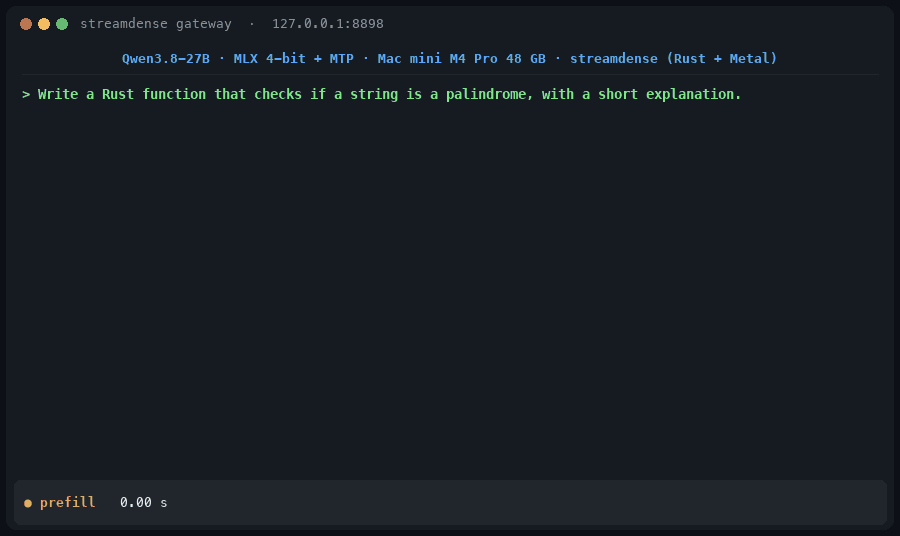

# streamdense

Rust + Metal + Swift inference engine for dense models on Apple Silicon. It runs Qwen3.8-27B (MLX 4-bit weights)
under a hard RAM cap, with MTP speculative decoding whose output is identical to plain greedy decoding, and serves it
over the Anthropic Messages API so coding agents (for example Claude Code) and the bundled SwiftUI app can use it locally.

<p align="center"></p>

<p align="center"></p>

## Headline numbers

Qwen3.8-27B, MLX 4-bit, greedy decode on a Mac mini M4 Pro (48 GB), one model process, under `sd-watchdog`.

| Peak RAM | Decode |
|---|---|
| 14.9 GB plain · 15.4–16.0 GB with MTP (hard cap 16 GB) | 14.3 tok/s plain · 17.1–25.2 tok/s with MTP (everyday prose to code) · 27.2 tok/s with MTP auto depth + fused verify |

- MTP and fused verify are lossless: every policy produces the same tokens as plain greedy decoding. Checked per
  position on the 27B (2026-11-15): at draft depths 2, 4, 7 and auto, on prose, code, arithmetic and repetitive prompts,
  in four engine setups (default; fused verify matmuls; batched verify attention, once on its short-context path and
  once with its batched two-pass kernels forced on), all 3,008 verified positions had f32 logits bit-identical to
  plain one-token decode, including positions where the top-2 logit gap was 0.04
  ([`mtp_exact_27b.rs`](engine/crates/streamdense-model/tests/mtp_exact_27b.rs)).

  | Prompt | Logits bit-identical (4 setups) | MTP acceptance, depth 2 / 4 / 7 / auto |
  |---|---|---|
  | Prose | 752 / 752 | 0.48 / 0.30 / 0.18 / 0.32 |
  | Code | 752 / 752 | 1.00 / 0.91 / 0.84 / 0.75 |
  | Arithmetic | 752 / 752 | 0.88 / 0.86 / 0.64 / 0.51 |
  | Repetitive | 752 / 752 | 1.00 / 1.00 / 1.00 / 0.86 |

  47 positions per run, 4 depths, 4 setups. Acceptance is for the default setup (forcing the two-pass kernels changes
  attention rounding for plain and MTP decode alike, so the prose reply and its acceptance differ there). Peak RAM
  15.4 GB, about 1 minute per run including the model load.

  Long contexts, where decode crosses the 1,024-key switch to two-pass attention and the 8,192-key switch to the
  split-K path (prompts built from this repo's source; 47 decode positions x 4 depths per run and setup):

  | Prompt tokens | Setups | Keys at decode: <1,024 / 1,024–8,192 / >8,192 | Logits bit-identical | Smallest top-2 gap |
  |---|---|---|---|---|
  | ~1,000 | default, batched verify attention | 23 / 24 / 0 | 376 / 376 | 0.034 |
  | ~4,000 | default | 0 / 47 / 0 | 188 / 188 | 0.0099 |
  | ~8,170 | default, batched verify attention, fused verify | 0 / 22 / 25 | 564 / 564 | 0.34 |
  | ~12,200 | default | 0 / 0 / 47 | 188 / 188 | 0.13 |
  | ~32,560 | default | 0 / 0 / 47 | 188 / 188 | 0.16 |

  In total 4,512 verified positions, short and long contexts, zero mismatches. The attention kernels are also checked
  on their own (no model, 0.26 GB): verify passes of 1–8 rows are bit-identical to one-row passes at 221 positions up
  to 32,768 keys, including the split-K chunk edges (`verify_attn_long_bit_identical` in `verify_bench.rs`).

  Decode speed by context (128 greedy tokens, timed without the checks; MTP output identical to plain in every run):

  | Context | KV | Plain | MTP auto | Peak RAM |
  |---|---|---|---|---|
  | ~12,200 | bf16 | 12.86 tok/s | 16.48 tok/s | 16.13 GB |
  | ~12,200 | 8-bit | 12.75 tok/s | 15.77 tok/s | 15.75 GB |
  | ~32,560 | bf16 | 11.39 tok/s | 14.34 tok/s | 17.58 GB |
  | ~32,560 | 8-bit | 11.30 tok/s | **14.82 tok/s** | **16.57 GB** |
  | Before: ~12,200 / ~32,560 | bf16 | 11.97 / 10.33 tok/s | 13.13 / 9.94 tok/s | 16.14 / 17.55 GB |

  The 12K rows were measured before the faster one-row attention below; the 32K bf16 row includes the re-measured
  auto-depth costs below.

  Copy-heavy output at long context (an edit prompt that rewrites the last 80 lines of the code in the prompt,
  8-bit KV, output identical to plain in every run):

  | Context | Plain | MTP auto | Context drafts | MTP + context drafts | Peak RAM |
  |---|---|---|---|---|---|
  | ~12,200 | 13.29 tok/s | 37.02 tok/s | 33.64 tok/s | **37.44 tok/s** | 15.77 GB |
  | ~32,560 | 12.41 tok/s | 27.98 tok/s | **35.50 tok/s** | 32.98 tok/s | 16.58 GB |

  MTP auto depth uses re-measured attention costs per key (the 8-bit table was 2.4–3x too steep) and weighs each
  acceptance estimate by how much evidence it has, so copy output keeps deep passes and prose gets shallower ones.
  MTP + context drafts (`[gateway] mtp_ctx_draft = 7`, default 0 = off) fills each pass from a suffix match in the
  context first, then MTP; on prose at 32K it is 8% slower than MTP alone (13.18 vs 14.34 tok/s), so it stays off.

  What changed: MTP auto depth now counts the attention cost of each verify row at long context, so MTP is faster
  than plain at 32K too (it was slower before); verify attention above 8,192 keys uses a faster split-K kernel (bf16
  and 8-bit KV); one-row decode attention shares key reads across the query heads of a KV head (21–31% faster from
  4K to 32K keys, bit-identical); and 8-bit KV is optional (`[gateway] kv = "q8"`, default bf16), saving about 1 GB
  at 32K. The fast prompt read now writes and reads 8-bit KV directly, so the 32K prompt reads in 453 s with 8-bit KV
  (950 s before, ~450 s with bf16). 32K with bf16 KV needs a RAM cap of about 18 GB.

  DFlash2 (optional drafter, off by default) at long context, output identical to plain: 15.17 tok/s at ~12,200
  (bf16 KV, plain 12.65, peak 16.66 GB) and 11.09 tok/s at ~32,560 (8-bit KV, plain 11.81, peak 17.06 GB). Its
  drafter sees only the last 2,048 positions, so acceptance drops to 0.24–0.29; MTP stays the default.

  For comparison, the Unsloth GGUF of the same model at the same size (`unsloth/Qwen3.8-27B-GGUF`, UD-IQ4_XS,
  14.35 GB) in llama.cpp (build 12110, Metal, flash attention, weights loaded into RAM, greedy, no speculative
  decoding), same prompts and machine:

  | Prompt | KV | llama.cpp (GGUF) | streamdense plain | streamdense best | Peak RAM (GGUF / ours) |
  |---|---|---|---|---|---|
  | ~12,200 summarize | 16-bit | 8.88 tok/s | 12.86 tok/s | 16.48 tok/s (MTP) | 16.29 / 16.13 GB |
  | ~32,560 summarize | 16-bit | 8.43 tok/s | 11.39 tok/s | 14.34 tok/s (MTP) | 17.66 / 17.58 GB |
  | ~32,560 summarize | 8-bit | 8.81 tok/s | 11.30 tok/s | 14.82 tok/s (MTP) | 16.66 / 16.57 GB |
  | ~32,560 edit | 8-bit | 8.98 tok/s | 12.41 tok/s | 35.50 tok/s (context drafts) | 16.66 / 16.58 GB |

  llama.cpp decodes at about 0.7x our plain speed and uses the same RAM; its prompt read (72–79 tok/s, 426–455 s
  at 32K) is about the same as ours. Its tokenizer gives the same token ids. llama.cpp's own MTP mode was not tested.
- Prompt reading (prefill) runs at about 75–80 tok/s cold. With KV prefix reuse, follow-up turns of a Claude Code
  session start in 0.4–1.5 s, and a new session that restores a snapshot of the shared system prompt starts in 0.66 s.
- Decode is memory-bandwidth bound: a full-model pass reads about 15 GB of weights, two thirds of it FFN.

## Requirements

- A Mac with Apple Silicon (Metal GPU) and enough unified memory for the 16 GB cap plus room for the
  OS.
- Rust (stable; CI pins 1.97.1). Xcode / Swift for the app (macOS 14+).
- About 15 GB of disk for the 4-bit model.

## Build

```sh
cd engine && cargo build --release
```

Binaries in `engine/target/release/`: `streamdense` (subcommands include `gateway`, `up`, `config`, `qwen`),
`sd-watchdog` (RAM cap guard) and `sd-fetch` (parallel Hugging Face downloader).

## Get the model

Weights are not part of this repository. Download the 4-bit MLX package
([p4ik/Qwen3.8-27B-MLX-4bit](https://huggingface.co/p4ik/Qwen3.8-27B-MLX-4bit)) into `models/qwen38_27b_mlx4`:

```sh
engine/target/release/sd-fetch repo --repo p4ik/Qwen3.8-27B-MLX-4bit --out models/qwen38_27b_mlx4 --resume
```

## Run

Gateway (Anthropic Messages API on `127.0.0.1:8898`), with every limit taken from `streamdense.toml`:

```sh
engine/target/release/streamdense up --log /tmp/gw.jsonl
```

`streamdense up` starts `sd-watchdog` + `nice` + `streamdense gateway` with the values from the config file; extra
arguments go to the gateway and win over the file (e.g. `streamdense up --max-ctx 12288 --no-mtp`). The long form:

```sh
B=engine/target/release
$B/sd-watchdog --cap-gb 16 --margin-gb 0 --swap-gb 7 -- nice -n 10 \
  $B/streamdense gateway --model models/qwen38_27b_mlx4 --port 8898 --max-ctx 8192 --mtp --log /tmp/gw.jsonl
```

Point Claude Code at it:

```sh
eval "$(engine/target/release/streamdense gateway --print-env --port 8898)"
claude --bare
```

Options, snapshots and the request log are described in [docs/GATEWAY.md](docs/GATEWAY.md).

## Supported models

The gateway above (MTP speculative decoding) is built for Qwen3.8-27B. Other dense models run through
`sd-model-layer`, plain greedy decoding, raw prompt (`--prompt`) or the model's chat template (`--chat`, every family below
except the StarCoder2 base model). Head dims 64 / 96 / 128 / 160 / 256.
Full guide, limits and example output: [engine/model_layer/README.md](engine/model_layer/README.md).

| Family | `model_type` | Engine | Notes |
|---|---|---|---|
| Qwen2 / Qwen2.5 dense | `qwen2` | [engine/dense-engine](engine/dense-engine/README.md) | head dim 64 / 128 (0.5B and up); checked against MLX on Qwen2.5-1.5B-Instruct and Qwen2.5-0.5B-Instruct |
| Qwen3 dense | `qwen3` | [engine/dense-engine](engine/dense-engine/README.md) | head dim 128; checked against MLX on Qwen3-1.7B and Qwen3-0.6B |
| Qwen3.5 / Qwen3.8 hybrid | `qwen3_5`, `qwen3_5_text` | main engine (`engine/crates/streamdense-model`) | Qwen3.8-27B; full features through the gateway; small models run through `sd-model-layer` (tied embeddings, no MTP): checked against MLX on Qwen3.5-0.8B |
| Llama (Llama 3.x, SmolLM) | `llama` | [engine/dense-engine](engine/dense-engine/README.md) | head dim 64 / 128 / 256, llama3 RoPE; checked against MLX on Llama-3.2-1B-Instruct and SmolLM-135M-Instruct ([results](engine/model_layer/README.md#llama-granite-gemma-vs-mlx-2026-11-14)) |
| Granite (dense) | `granite` | [engine/dense-engine](engine/dense-engine/README.md) | Granite multipliers; checked against MLX on granite-4.2-3b ([results](engine/model_layer/README.md#llama-granite-gemma-vs-mlx-2026-11-14)); MoE / Mamba-hybrid Granite refused |
| Gemma 1 | `gemma` | [engine/dense-engine](engine/dense-engine/README.md) | tanh GELU (per config); checked against MLX on gemma-1.1-2b-it ([results](engine/model_layer/README.md#llama-granite-gemma-vs-mlx-2026-11-14)) |
| Gemma 2 | `gemma2` | [engine/dense-engine](engine/dense-engine/README.md) | soft caps, sliding window; checked against MLX on gemma-2-2b-it, also past the 4096-token window (16 / 16 at 4331 prompt tokens vs a correctly windowed reference) ([results](engine/model_layer/README.md#llama-granite-gemma-vs-mlx-2026-11-14)) |
| Gemma 3 (text) | `gemma3_text` | [engine/dense-engine](engine/dense-engine/README.md) | head dim 256, sliding window; checked against MLX on gemma-3-270m-it; past the 512-token window the misses are bf16 near-ties (layer-by-layer check, no bug found) ([results](engine/model_layer/README.md#llama-granite-gemma-vs-mlx-2026-11-14)) |
| Mistral | `mistral` | [engine/dense-engine](engine/dense-engine/README.md) | Llama layer math, `[INST]` chat templates (v0.3, Nemo, Tekken); checked against MLX on Mistral-7B-Instruct-v0.3 ([results](engine/model_layer/README.md#more-families-vs-mlx-2026-11-15)) |
| Phi-3 / Phi-3.5 / Phi-4-mini | `phi3` | [engine/dense-engine](engine/dense-engine/README.md) | fused qkv / gate_up, partial rotary, LongRoPE (as mlx_lm), head dim 96 / 128; checked against MLX on Phi-4-mini-instruct and Phi-3.5-mini-instruct; prompts over 4096 tokens not exercised ([results](engine/model_layer/README.md#more-families-vs-mlx-2026-11-15)) |
| OLMo 2 | `olmo2` | [engine/dense-engine](engine/dense-engine/README.md) | post-norm layers, q / k norm over the whole projection; checked against MLX on OLMo-2-1124-7B-Instruct ([results](engine/model_layer/README.md#more-families-vs-mlx-2026-11-15)) |
| SmolLM3 | `smollm3` | [engine/dense-engine](engine/dense-engine/README.md) | no-RoPE layers; chat template with the local date (as HF); checked against MLX on SmolLM3-3B ([results](engine/model_layer/README.md#more-families-vs-mlx-2026-11-15)) |
| GLM-4 (0414) | `glm4` | [engine/dense-engine](engine/dense-engine/README.md) | four norms, fused gate_up, interleaved partial RoPE; checked against MLX on GLM-4-9B-0414 ([results](engine/model_layer/README.md#more-families-vs-mlx-2026-11-15)) |
| StableLM 2 | `stablelm` | [engine/dense-engine](engine/dense-engine/README.md) | LayerNorm, sequential or parallel residual, per-head LayerNorm QK-norm, partial RoPE, head dim 64 / 160 (160 synthetic-tested only); checked against MLX on stablelm-2-1_6b-chat ([results](engine/model_layer/README.md#more-families-vs-mlx-2026-11-15)) |
| Command R7B | `cohere2` | [engine/dense-engine](engine/dense-engine/README.md) | LayerNorm, parallel block, sliding layers + no-RoPE full layers, logit scale; checked against MLX on c4ai-command-r7b-12-2024 ([results](engine/model_layer/README.md#more-families-vs-mlx-2026-11-15)) |
| StarCoder2 | `starcoder2` | [engine/dense-engine](engine/dense-engine/README.md) | LayerNorm, non-gated GELU MLP, biases; base model, `--prompt` only (no chat template); checked against MLX on starcoder2-3b ([results](engine/model_layer/README.md#more-families-vs-mlx-2026-11-15)) |

MLX 4-bit (group 64) weights only. MoE models and other families are refused by name.

```sh
cd engine/model_layer && cargo build --release
B=engine/model_layer/target/release
$B/sd-model-layer inspect models/<model_dir>                                  # family, engine, what applies; reads no weights
$B/sd-model-layer run models/<model_dir> --prompt "def fibonacci(n):" --max-tokens 48
$B/sd-model-layer run models/<model_dir> --chat "Name three primary colors." --max-tokens 32   # all families
```

## Configuration

`streamdense.toml` at the repo root holds the RAM cap and the run settings for every model run (gateway, `qwen serve`,
the app): `[ram]` (`cap_gb = 16.0`, `swap_gb = 7`, `margin_gb = 0`, `nice = 10`), `[gateway]` (model, port 8898,
max_ctx 8192, MTP, speculative depth, matmul family), `[watcher]`, `[snapshots]` and `[history]`. The cap is enforced on the real footprint: `sd-watchdog` stops the process and the
engine aborts itself above it.

`streamdense config` prints the resolved values and where they came from; command-line flags override the file.
Search order: `$SD_CONFIG`, `./streamdense.toml`, the repo root, `~/.config/streamdense/config.toml`.

## App

Native SwiftUI chat app (`app/`, macOS 14+). It starts the engine itself under `sd-watchdog` (cap from
`streamdense.toml`) and talks to it over the JSON-lines protocol in [docs/SERVE_PROTOCOL.md](docs/SERVE_PROTOCOL.md).

```sh
cd engine && cargo build --release      # engine binaries the app spawns
app/run.sh                              # RAM gate, builds the app if needed, opens the window
app/run.sh --autoload                   # same, and loads the 27B at startup
```

Quitting the app stops the engine and frees its RAM.

## Tests

Fast set (no `models/`, no GPU; what CI runs, `.github/workflows/ci.yml`):

```sh
cd engine && cargo fast          # alias in engine/.cargo/config.toml; add `-- --show-output` to see SKIP lines
```

Plain `cargo test` in `engine/` also runs the Metal GPU tests and the tests that use a small test model in `models/`;
without weights they print `SKIP: ...` and return. Lints: `cargo clippy --workspace --all-targets --locked -- -D warnings`
(allowed style lints and why are listed in `engine/Cargo.toml`).

## History

Development started on 2026-10-31. The public git history begins on 2026-11-14, when the code was first published.

## License

[PolyForm Strict License 1.0.0](https://polyformproject.org/licenses/strict/1.0.0): see [`LICENSE`](LICENSE). You may
download, build and run streamdense for noncommercial purposes. Commercial use, modification and redistribution are not
permitted without written permission from the copyright holder. Third-party code, crates and models keep their own
licenses: see [`THIRD_PARTY_NOTICES.md`](THIRD_PARTY_NOTICES.md). Model weights are not part of this repo.
