# streamdense

Rust + Metal + Swift inference engine for dense models on Apple Silicon. It runs Qwen3.8-27B (MLX 4-bit weights)
under a hard RAM cap, with MTP speculative decoding whose output is identical to plain greedy decoding, and serves it
over the Anthropic Messages API so coding agents (for example Claude Code) and the bundled SwiftUI app can use it locally.

<p align="center"></p>

<p align="center"></p>

## Headline numbers

Qwen3.8-27B, MLX 4-bit, greedy decode on a Mac mini M4 Pro (48 GB), one model process, under `sd-watchdog`.

| Mode | Peak RAM | Decode |
|---|---|---|
| Full model (all weights in RAM, hard cap 16 GB) | 14.9 GB plain · 15.4–16.0 GB with MTP | 14.3 tok/s plain · 17.1–25.2 tok/s with MTP (everyday prose to code) · 27.2 tok/s with MTP auto depth + fused verify |
| 12 GB mode (part of each FFN layer in RAM, chosen per prompt; off by default) | 11.76 GB | 19.7 tok/s plain |

- MTP and fused verify are lossless: every policy produces the same tokens as plain greedy decoding.
- Prompt reading (prefill) runs at about 75–80 tok/s cold. With KV prefix reuse, follow-up turns of a Claude Code
  session start in 0.4–1.5 s, and a new session that restores a snapshot of the shared system prompt starts in 0.66 s.
- 12 GB mode quality on checkable prompts (code run against tests, arithmetic / logic, facts): 96 / 101 vs 100 / 101
  for the full model; the extra misses are code.
- Decode is memory-bandwidth bound: a full-model pass reads about 15 GB of weights, two thirds of it FFN.

## Requirements

- A Mac with Apple Silicon (Metal GPU) and enough unified memory for the chosen mode (16 GB cap for the full model,
  about 12 GB for the 12 GB mode, plus room for the OS).
- Rust (stable; CI pins 1.97.1). Xcode / Swift for the app (macOS 14+).
- About 15 GB of disk for the 4-bit model.

## Build

```sh
cd engine && cargo build --release
```

Binaries in `engine/target/release/`: `streamdense` (subcommands include `gateway`, `up`, `config`, `qwen`, `forheader`),
`sd-watchdog` (RAM cap guard) and `sd-fetch` (parallel Hugging Face downloader).

## Get the model

Weights are not part of this repository. Download the 4-bit MLX package
([p4ik/Qwen3.8-27B-MLX-4bit](https://huggingface.co/p4ik/Qwen3.8-27B-MLX-4bit)) into `models/qwen38_27b_mlx4`:

```sh
engine/target/release/sd-fetch repo --repo p4ik/Qwen3.8-27B-MLX-4bit --out models/qwen38_27b_mlx4 --resume
```

## Run

Gateway (Anthropic Messages API on `127.0.0.1:8898`), with every limit taken from `streamdense.toml`:

```sh
engine/target/release/streamdense up --log /tmp/gw.jsonl
```

`streamdense up` starts `sd-watchdog` + `nice` + `streamdense gateway` with the values from the config file; extra
arguments go to the gateway and win over the file (e.g. `streamdense up --max-ctx 12288 --no-mtp`). The long form:

```sh
B=engine/target/release
$B/sd-watchdog --cap-gb 16 --margin-gb 0 --swap-gb 7 -- nice -n 10 \
  $B/streamdense gateway --model models/qwen38_27b_mlx4 --port 8898 --max-ctx 8192 --mtp --log /tmp/gw.jsonl
```

Point Claude Code at it:

```sh
eval "$(engine/target/release/streamdense gateway --print-env --port 8898)"
claude --bare
```

Options, snapshots, the 12 GB mode and the request log are described in [docs/GATEWAY.md](docs/GATEWAY.md).

## Configuration

`streamdense.toml` at the repo root holds the RAM cap and the run settings for every model run (gateway, `qwen serve`,
the app): `[ram]` (`cap_gb = 16.0`, `swap_gb = 7`, `margin_gb = 0`, `nice = 10`), `[gateway]` (model, port 8898,
max_ctx 8192, MTP, speculative depth, matmul family), `[watcher]`, `[forheader]` (12 GB mode, commented out = off),
`[snapshots]` and `[history]`. The cap is enforced on the real footprint: `sd-watchdog` stops the process and the
engine aborts itself above it.

`streamdense config` prints the resolved values and where they came from; command-line flags override the file.
Search order: `$SD_CONFIG`, `./streamdense.toml`, the repo root, `~/.config/streamdense/config.toml`.

## 12 GB mode (Forheader)

Forheader is a memory-limited mode that keeps the most useful part of each FFN layer in RAM for the current prompt and
reads the prompt itself with the full FFN streamed from the SSD, so the 27B runs in about 12 GB. It is off by default;
turn it on with `[forheader] mode = "12gb"` in `streamdense.toml` (or `streamdense gateway --forheader 12gb`) after
installing its score file once with `streamdense forheader install FILE` (the score file is not part of this
repository). Details: [docs/GATEWAY.md](docs/GATEWAY.md) ("12 GB mode").

## App

Native SwiftUI chat app (`app/`, macOS 14+). It starts the engine itself under `sd-watchdog` (cap from
`streamdense.toml`) and talks to it over the JSON-lines protocol in [docs/SERVE_PROTOCOL.md](docs/SERVE_PROTOCOL.md).

```sh
cd engine && cargo build --release      # engine binaries the app spawns
app/run.sh                              # RAM gate, builds the app if needed, opens the window
app/run.sh --autoload                   # same, and loads the 27B at startup
```

Quitting the app stops the engine and frees its RAM.

## Layout

| Path | What |
|---|---|
| `engine/` | Rust workspace: `crates/streamdense-{core,metal,model,tokenizer,gateway,cli,fetch}`, Metal shaders (`shaders/`), kernel test vectors and request fixtures (`testdata/`) |
| `engine/refs/` | Reference outputs (greedy tokens, teacher logits, dumps) read by the engine tests and checks |
| `app/` | SwiftUI chat app for `qwen serve` (`Sources/StreamdenseChat`, `run.sh`) |
| `docs/` | [ARCHITECTURE.md](docs/ARCHITECTURE.md), [GATEWAY.md](docs/GATEWAY.md), [SERVE_PROTOCOL.md](docs/SERVE_PROTOCOL.md) |
| `streamdense.toml` | RAM cap and run settings |
| `models/` | Model weights, not tracked |

## Tests

Fast set (no `models/`, no GPU; what CI runs, `.github/workflows/ci.yml`):

```sh
cd engine && cargo fast          # alias in engine/.cargo/config.toml; add `-- --show-output` to see SKIP lines
```

Plain `cargo test` in `engine/` also runs the Metal GPU tests and the tests that use a small test model in `models/`;
without weights they print `SKIP: ...` and return. Lints: `cargo clippy --workspace --all-targets --locked -- -D warnings`
(allowed style lints and why are listed in `engine/Cargo.toml`).

## License

[PolyForm Strict License 1.0.0](https://polyformproject.org/licenses/strict/1.0.0): see [`LICENSE`](LICENSE). You may
download, build and run streamdense for noncommercial purposes. Commercial use, modification and redistribution are not
permitted without written permission from the copyright holder. Third-party code, crates and models keep their own
licenses: see [`THIRD_PARTY_NOTICES.md`](THIRD_PARTY_NOTICES.md). Model weights are not part of this repo.
